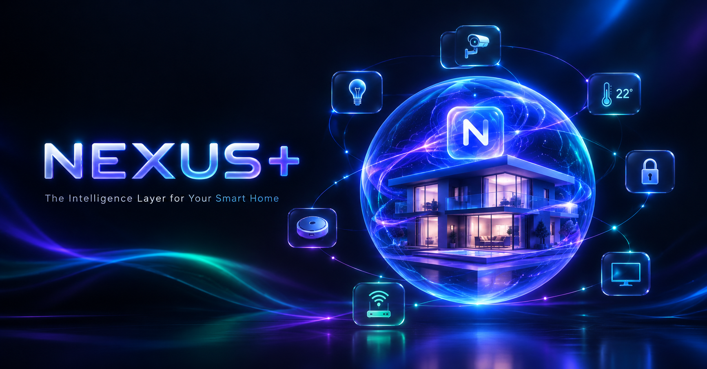
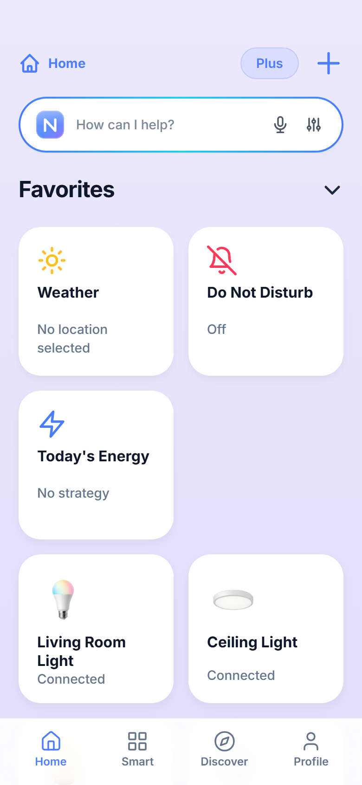
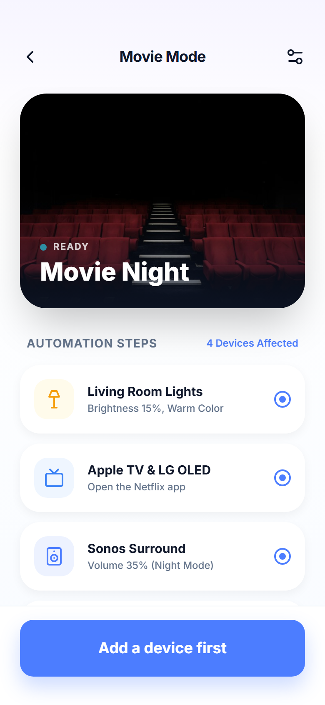
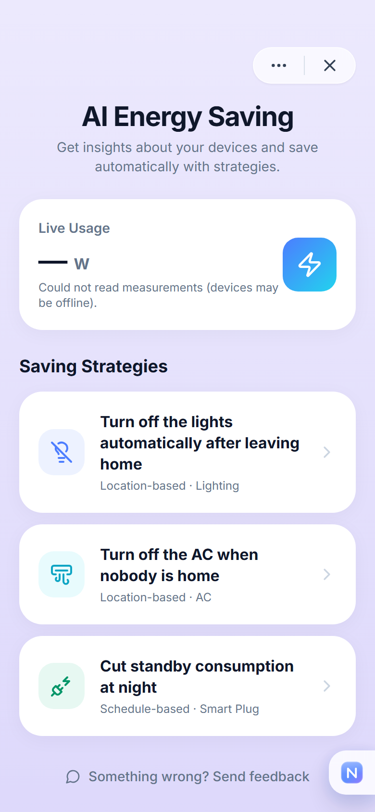
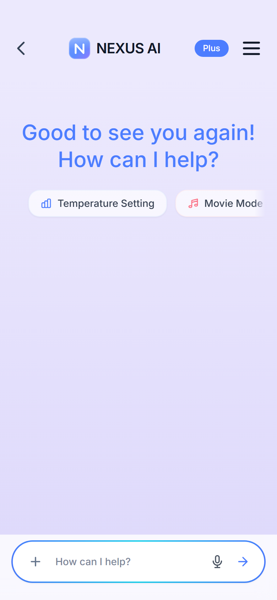
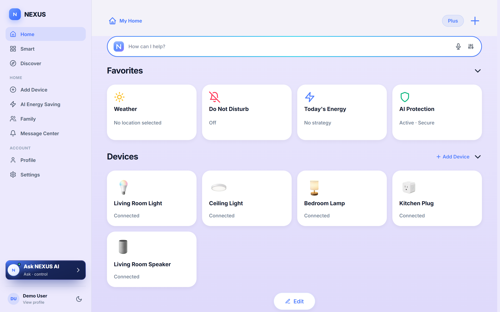

<p align="center">
  
</p>

# NEXUS — local-first smart home

One app that talks to your devices **directly on your local network** — no hub, no
vendor cloud, no subscription required. Windows · Linux · Android. macOS & iOS build from source.

> **House rule: the app never pretends.** Real device states, automations that
> actually run, honest energy numbers. Anything not supported yet is clearly
> labelled in the UI.

<p align="center">
  
  
  
  
</p>

## Why NEXUS

- **Local-first control.** Shelly, Tasmota, WLED, ESPHome, Philips Hue and Home
  Assistant over local HTTP; TP-Link Kasa and Yeelight over local TCP. Pairing is
  instant LAN discovery — no account creation per device.
- **Desktop with real tray automations.** The Windows/Linux program runs the same
  UI in a desktop shell with a sidebar, sits in the system tray, and keeps
  schedules and sunset triggers running even with the window closed.
- **Built-in AI assistant, free tier included.** Chat runs device commands locally
  ("turn off the living room lights", "set the AC to 22"); cloud fallback uses a
  multi-provider chain (Cloudflare → Groq → Gemini → OpenRouter) with a free
  daily credit quota.
- **Privacy by architecture.** Device commands never leave your network. Cloud
  sync is optional and stores only profile/settings — never device credentials.
- **Bilingual UI** (English/Turkish) with an automated 100% translation-coverage
  gate.

## Desktop

The desktop program is not a wrapped web page — it gets a dedicated wide layout
with a navigation sidebar, tray mode and background automation worker:

<p align="center">
  
</p>

## Screens & app

| Platform | Install |
| --- | --- |
| Windows x64 + arm64 | [Download installer](https://github.com/Enard52/nexus-releases/releases/latest) (auto-update built in) |
| Linux x64 | AppImage + deb from the same releases page |
| Android | Signed APK from the same releases page |
| macOS / iOS | Build configs ready in-repo — see [docs/BUILD-ALL-PLATFORMS.md](docs/BUILD-ALL-PLATFORMS.md) |
| Web | [nexus-smarthome.pages.dev](https://nexus-smarthome.pages.dev) — account, downloads & billing |

## Architecture (single source, three shells)

```
src/app (single source)                generated copies — never edit by hand
├─ nexus-*.html   62 screens  →  www/  (sync-www.mjs)        → same UI in desktop & Android
├─ *.js (theme, data, device-    →  desktop/app (prepare-app)  → Electron (nexus:// protocol)
│  controls, lan-connectors,     →  android assets (cap sync)  → Capacitor APK (signed)
│  automation-engine.js)
├─ css/            design system + shell metrics (--nx-header-h/--nx-nav-h)
├─ www/public/     marketing site (site-content.mjs + site-build.mjs) → nexus-smarthome.pages.dev
├─ supabase/       Edge Functions + migrations (accounts, billing webhooks, invites)
├─ scripts/        build/verify tooling (measure-layout, verify-site, site-*, legal-pdf…)
├─ packages/       unit-tested modules (vitest: 1045 tests) — mirror & hygiene guards included
└─ desktop/        Electron main/preload (tray mode, auto-update, automation worker)
```

- **Accounts & sync:** Supabase (email + Google); device data stays local.
- **Billing:** Whop (NEXUS+ monthly/yearly, TRY/USD) → signed webhook → entitlements.
- **Automations:** `automation-engine.js` runs on-device; survives on the desktop
  tray (`automation-worker.html`).

## Development

```bash
pnpm install
pnpm test                              # full suite (unit + guard tests)
node scripts/sync-www.mjs              # root → www
node desktop/scripts/prepare-app.cjs   # → desktop/app
npx cap sync android                   # → android (rebuild APK for release)
npm run audit:ui                       # 63 screens × 4 device profiles audit
npm run audit:i18n:coverage            # translation coverage gate
```

Release flow: push to `main` → marketing site deploys; tag `v*` → signed desktop +
Android builds land in
[nexus-releases](https://github.com/Enard52/nexus-releases) (checksums + SBOM).

## Documentation

- `docs/ARCHITECTURE.md` — the full architecture map (single source, shells, security posture, release flow)
- `docs/BUILD-ALL-PLATFORMS.md` — platform build matrix
- `docs/INTEGRATIONS.md` — integration roadmap (zero-budget first)
- `docs/USABILITY.md` — usability audit results and next quick wins
- `CLAUDE.md` — contributor rules (honesty, secrets, single-source pricing)
- Legal (TR/EN): `legal-pdf/` — regenerate with `node scripts/legal-pdf.mjs`

## License

[Apache-2.0](LICENSE) — the same license Home Assistant uses: anyone may use,
modify and ship NEXUS, with an explicit patent grant. The NEXUS name and logo
stay with the project (see `TRADEMARKS.md`).
